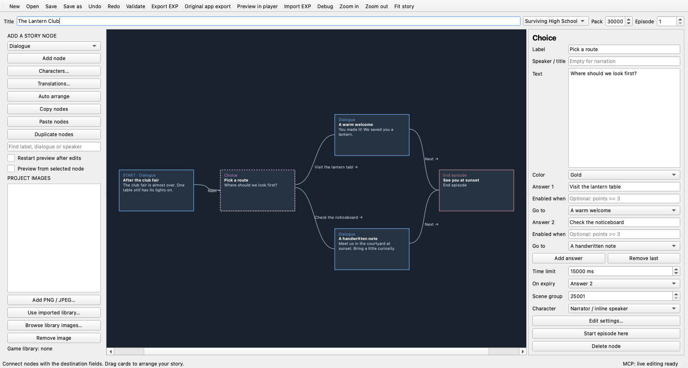
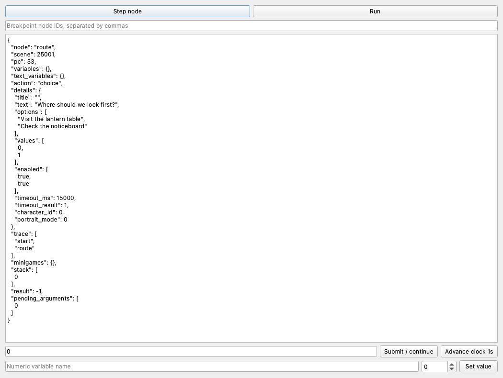
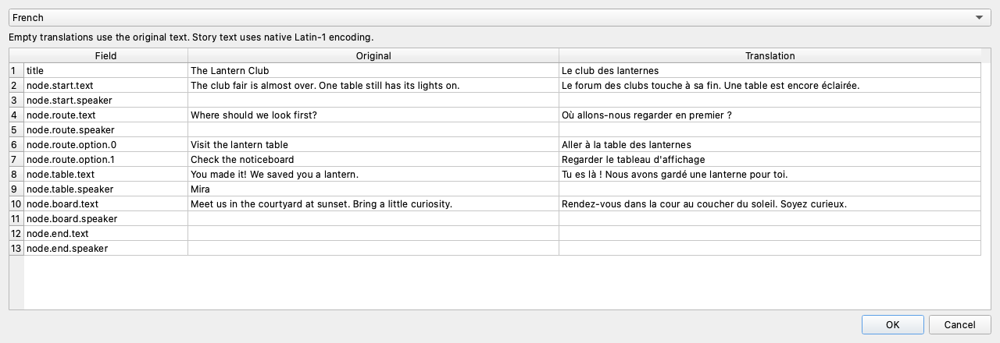

# Episode creator

The optional desktop creator authors **new SHS and CoD episodes** for EXP
Runtime and the original games. It exports the native CSPUD `.exp` container
with KiWi v2 bytecode. Authored scripts pass checks against the original
SHS Android, SHS iOS and CoD iOS loaders and interpreters; full playback in
the original apps remains unverified. See the compatibility details below.
The creator is new in v0.6.0. Download the `exp-runtime-creator-v0.6.0-<target>`
archive from Releases for Windows, Linux or macOS, extract it, and open
**EXP Runtime Creator**. Keep the complete app or executable directory together.
Python and Qt are bundled. Alternatively, install with pip:

```sh
python -m pip install 'exp-runtime[creator]>=0.6.0'
exp-creator
```

To run from this checkout:

```sh
uv run --locked --extra creator exp-creator
```

The screenshots below use an authored example episode, **The Lantern Club**.
Select an image to view it at full size.

[](images/creator/story-graph.png)

The selected choice connects to two dialogue paths. Its inspector sets a
15-second time limit and selects Answer 2 when time runs out.

## Make an episode

1. Choose **Surviving High School** or **Cause of Death**, then enter a title,
   pack ID and episode ID. IDs are author-assigned; they do not create native
   catalog entries. Use **Translations** to edit the five title fields and
   story text, and choose the language used by export and preview.
2. Select a node type and press **Add node**. Select its card to edit dialogue,
   connections and character/expression selection. **Edit settings** opens typed
   fields and nested row editors for that node's parameters. **Characters**
   creates reusable speaker definitions using image IDs from the project list.
3. Connect **Next**, condition branches and each choice answer. A choice has
   two to eight answers, optional numeric enable conditions, a timer with an
   explicit default, and optional native random ordering. Start-node selection
   is independent of card order.
4. Save an editable `.expproj` document. **Validate** compiles in memory.
   **Export EXP** produces an episode for the player's usual EXP/ZIP/RAR import.
   Unfinished graphs can be saved; invalid exports never replace an older file.

| Node/control | Authoring behavior |
| --- | --- |
| Dialogue, choice | Narration, named text, portraits, expressions 0–4, native themes, timed answers and conditional options |
| Background, pan | Image selection, automatic speaker tracking or left/center/right alignment |
| Music, sound, stop audio | Native resource IDs, looping flag, immediate runtime stop; listen using an imported library |
| Relationship | Add/set character property 407, hide indicators, select romance, store the resulting number in a variable |
| Score/property | Add/set an explicit native owner/key, optional dialogue notification, and a result variable |
| Set variable, condition | Signed-word arithmetic, comparisons, boolean conditions and increments such as `points + 1` |
| Random variable | Native service 27 with an exclusive positive upper bound; save result for branches |
| Text input, text answer condition | Native name/input panel, stored `{variable}` substitution and native string comparison |
| Title, message, notification, scene label | Existing title/message panels, queued dialogue notices and scene badges |
| Emphasize, transition, close dialogue | Existing engine presentation commands; retain its documented native parity limits |
| Timed word choices | Good/bad word lists, time limits, refresh interval, character and returned score; both games |
| Football | Six interleaved offense/defense tables, instructions, teams, clocks, flags and returned margin; SHS only |
| Word/picture grid | Problems, alphabets, picture symbols, fixed tutorial boards, timing, tutorial branches and returned result; SHS only |
| Scene link/group | Connect any nodes across scene groups; compiler schedules separate native scripts |
| End episode | Native service 7 returns to the existing game menu; use its episode picker to play another installed story |

Minigame settings contain authored example data. Football play rows are
`[code, yards, variation, weight]`; picture symbols are `[character, image ID]`.
The row editors let you add, edit, duplicate and reorder tables. Choice and
word-game portraits use native expression zero; expression selection applies
to character dialogue. See
[MINIGAMES.md](MINIGAMES.md) for the recovered record meanings. CoD's supplied
native 94/96 handlers are no-ops, so football and grid exports are rejected for
CoD. Result variables can be used by ordinary conditions after the game.

Score/property does not claim that every story uses the same score key. Choose
an owner/key deliberately; numeric graph variables are separate. Relationship
icons and gain/loss animation follow the engine's native rules on subsequent
character dialogue, including cached prior values. They are not arbitrary
animation clips. Five custom expression images are copied to a consecutive
native bank; arbitrary combinations of external base references cannot be
remapped without embedding their images.

Expressions support integers, variable names, `+`, `-`, `*`, `//`, `%`,
comparisons and `and`/`or`/`not`. Booleans short-circuit. Arithmetic follows
native signed 16-bit wrapping and **truncation toward zero**, including `//`;
it is not Python floor division. Calls, attribute access and evaluation of
Python code are prohibited. Unread numeric variables start at zero.

Undo/redo covers graph, character and translation changes. Copy/paste preserves
internal connections; duplicate, search and auto-arrange work on authored
nodes. Autosave writes a separate recovery document every 15 seconds while
work is dirty. On launch, the editor offers recovery; saving or intentionally
closing/discarding removes that window's recovery document. Canceling an
unsaved-work prompt preserves it. Project and EXP writes are atomic.

## Images and imported game assets

**Add PNG / JPEG** embeds an image in the project. Embedded images are portable:
moving the project or deleting the original image does not break the export.
The creator allocates episode resource IDs from 26000, reserving five IDs for
each image so unrelated images cannot become portrait expression variants.
Use artwork sized for the original game's portrait/background presentation;
the shared renderer retains its usual scaling and masking rules.

The desktop creator automatically uses the player's existing library for the
selected game, including a custom location remembered by the player. A project
with a saved library selection keeps it. Discovery only reads the library;
assets and player saves remain in place. If no usable library is found, you
can still create and export stories with your own images.

**Use imported library** lets you select a different game folder containing
`library.json`, created by importing your APK/IPA through the player.
**Browse library images** shows base resources and imported episode banks,
with a preview of single images. Numeric IDs are retained because original
archives do not always provide descriptive filenames. Fonts, scripts and UI
atlases are not offered as usable single images.

- Base images remain references to the selected game's resources. They are
  not copied into the exported episode. Recipients must supply the corresponding
  game assets through the usual player import, or use the matching original
  game. A base ID must exist in the version they play; the EXP does not include
  missing base assets from a different APK/IPA.
- Episode images are copied into the project and assigned local IDs. The
  source episode is no longer required. Embedded images are included in the
  exported EXP; review which assets you intend to distribute.
- SHS and CoD libraries stay separate. The project game must match the selected
  library. Switching games in a project without base assets or native scripts
  selects that game's player library. Once you use base images, music/sound
  IDs or native scripts, start a new project to change games. The format itself
  does not identify a game: import the export under the same game you selected
  in the creator.

No original content ships with the editor. A project can be edited and
exported without a game library, using narration and your own images.

## Preview

**Preview in player** runs the compiled episode in the shared desktop player
with an imported game library and temporary saves. **Preview from selected
node** starts there with freshly initialized state. **Restart preview after
edits** recompiles and restarts the preview after an edit; it does not patch a
running VM or retain its old variables. The source library and its saves stay
unchanged. Import exported stories into a player library to test the normal
end-of-episode menu and select another story through its existing picker.

## Live editing with a model

Open a saved `.expproj` inside your [MCP client's workspace](MCP.md). When the
status bar says **MCP: live editing ready**, the model reads your unsaved edits
and its changes appear in the graph and inspector immediately. Each model
transaction is one undoable edit; **Undo** and **Redo** work across human and
model changes. **Save** writes the shared document to disk. Autosave recovery
also retains accepted model edits.

The model must reread if you change the project after its last read. It cannot
edit while you have a modal dialog open or are dragging a card. Only one
desktop window can own a project. If another program changes the saved file,
use **Save as** to retain your draft or reopen the file to use that program's
changes. Closing the project returns MCP to the saved file; a disconnected
desktop is reported as an error rather than silently overwritten.

The conversation remains in your MCP client.

## Debugging

**Debug** uses the production VM without requiring a window or base art. Step
by source node, run to comma-separated breakpoint IDs, inspect/change numeric
variables, submit actual inputs and advance the clock. It shows native PCs,
pending frames and minigame state. A missing base resource cannot be diagnosed
visually in this headless debugger; use player preview for layout and audio.
Unknown services and opcodes still stop explicitly. The debugger never inserts
a winning minigame result. MCP additionally exposes grid pointer phases.

[](images/creator/debugger.png)

The debugger is waiting for the same choice shown above. Enter `0` to choose
the first answer, or use **Advance clock 1s** to exercise the timeout.

## Scenes, translations and existing EXPs

Assign different **Scene group** values to split a story into scripts. Native
resource 25001 initializes characters/state; multiple groups are assigned
resources 25002 onward and connected using service 10 followed by HALT.
Multi-scene numeric variables use the reserved authoring owner `-30000`,
with key `-1` for the next node and nonnegative keys for variables. Do not use
that owner for explicit Score/property nodes. Single-scene projects retain
initialized script-memory variables. Native scene loading clears its usual UI
and expression history.

Translations cover title, dialogue, choices, character names and minigame text.
The EXP holds all five metadata titles and **one compiled story language**,
selected in Translations or with `--language`. Export separate files for other
story languages. Missing translations fall back to the authored text. Story
text uses Latin-1; title metadata uses UTF-8. Translated grid alphabets and
words must still agree.

[](images/creator/translations.png)

Select a language to edit its text alongside the originals. Empty translation
cells keep the original text.

**Import EXP** restores high-level graphs from this creator's exports. For an
older/original EXP it produces a graph of native basic blocks, retaining every
resource and instruction, including unknown calls. Select the project game
before importing because the native container does not identify it. Native
blocks expose instructions and data words; packed-text candidates can be edited
within their original allocation after checking the word address. Instruction
counts and data-bank lengths remain fixed to preserve branch/callback addresses.
These are native block edits, not inferred dialogue/choice decompilation.

```sh
uv run --locked python -m exp_runtime.creator imported.expproj \
  --import-exp original.exp --game cod
uv run --locked python -m exp_runtime.creator story.expproj \
  --language fr --export story-fr.exp
```

The project schema is version 2 and migrates version 1 documents on read.
Exports include optional resource 2 with `EXP-RUNTIME-AUTHORED\0` followed by
versioned JSON: graph, source locations and variable/character mappings.
Embedded image bytes stay in their own resource records; private library paths
are omitted. The native scripts do not depend on this extension. Imported
original archives retain their resources rather than acquiring a guessed graph.

## Export for an original app

The original apps select episodes through their own catalogs. They do not have
the runtime's general-purpose EXP import picker. **Original app export** creates
a replacement for an existing episode slot:

1. Choose an existing EXP from the matching original game that is already
   present in that installation's catalog.
2. Save the replacement to a separate location. The compiler keeps that EXP's
   pack and episode IDs and writes your authored story, title and images.
   It leaves the reference file and your project's assigned IDs unchanged.
3. On a compatible installation, back up its episode and save data, then place
   the replacement where that catalog expects the existing EXP, using the
   expected filename. Access to the app's episode storage is required; this
   step depends on the device, platform and installation.
4. Start that episode from the beginning. An existing save's script positions
   belong to the old story and cannot be reused with the replacement.

This flow does not create native catalog entries, install files on a device,
or repackage/sign an APK or IPA. The original catalog may still display the
old episode name. Bundled episodes can have special app-bundle lookup paths;
putting a replacement in the downloaded-episode folder is not sufficient for
those slots. Prefer a downloaded episode when testing.

The equivalent headless export is:

```sh
uv run --locked python -m exp_runtime.creator story.expproj \
  --native-slot /path/to/original/Existing_Episode.exp \
  --export /path/to/replacements/Existing_Episode.exp
```

### Native compatibility evidence

The compiler uses the native entry script ID `25001`, literal CSPUD records,
KiWi v2 instruction encoding and recovered host-service argument contracts.
Ghidra inspection covers the resource loaders and game host calls. A separate
ARM emulation check runs authored exports through the actual KiWi loader and
interpreter from each supplied reference binary:

| Profile | KiWi loader | Interpreter | CSPUD loader |
| --- | --- | --- | --- |
| SHS Android 1.0.9 (`libshs09.so`) | `00057068` | `00055ce0` | `0005e4c0` |
| SHS iOS (`Surviving_HS`) | `00010e9c` | `00011410` | `00017334` |
| CoD iOS (`CoD`, ARMv6 slice) | `0000d53c` | `0000cb8c` | `00007250` |

`tools/test_creator_native.py` pins the SHA-256 identities of those binaries.
It checks 41 SHS programs per platform and 39 CoD programs, covering comparison
operators, choices, arithmetic/boolean control flow, initialized variables and
the newly exposed presentation, audio, input and minigame argument frames. Native yield arguments and script memory must match
the production Python VM. The harness supplies stream I/O, allocation and
host callback results. It does **not** run the original UI, timers, image
decoder, catalog installation or OS integration. CSPUD compatibility is based
on the inspected native loaders and the format's round-trip tests, not an
emulated app launch.

With a matching locally supplied binary, developers can repeat the optional
check without adding Unicorn to the player dependencies:

```sh
uv run --locked --with 'unicorn>=2,<3' python tools/test_creator_native.py \
  --profile cod-ios --binary /path/to/CoD
```

Use `shs-ios` or `shs-android` with the corresponding binary for the other
profiles. No original code or assets are included in the tool. Original-app
playback is still a required verification step before claiming complete native
compatibility; a compatible installation is not currently available for it.

## Python API and package boundaries

`exp-runtime-creator` contains the headless document model and compiler and
depends only on `exp-runtime-formats`. Its `[desktop]` extra adds Qt for Python
(`PySide6-Essentials`), the existing desktop player and both game adapters. The
umbrella's `[creator]` extra selects that complete editor. Ordinary player
installs and desktop/iOS player bundles exclude the creator and Qt.

Starting with v0.6.0, `python -m pip install 'exp-runtime[creator]>=0.6.0'`
installs the visual editor. Source checkouts and locally built wheels support
the same authoring API.

```python
from pathlib import Path
from exp_runtime.creator import Project, load_project, save_project, export_project

project = Project(title="My episode", game="cod")
project.node("start").text = "A new story begins."
save_project(project, Path("story.expproj"))
export_project(load_project(Path("story.expproj")), Path("story.exp"))
```

Headless export does not load Qt or the game library:

```sh
uv run --locked python -m exp_runtime.creator story.expproj --export story.exp
```

The general `exp_runtime.formats.encode_exp({resource_id: payload_bytes})`
writer and `Metadata.to_bytes()` also work independently of the creator. The
writer emits deterministic literal records; it does not preserve an existing
archive's compression, aliases or physical layout.

## Remaining compatibility limits

Full playback and installation in original apps still require a compatible
installation. The native harness verifies loaders, instructions, memory and
yield frames; it supplies host callbacks and cannot prove original UI behavior.
The creator inherits documented runtime presentation/audio limitations; it does
not add original fade/channel semantics or complete animation parity.

**End episode** compiles to the existing native service 7 and uses the normal
episode-exit/menu flow in both games. Players choose another story through the
existing episode picker. No custom next-episode instruction or playback metadata
is required. See [the native exit contract](STORY_SERVICES.md#episode-exit-services-7-and-63).

Earlier unreleased **Next episode** nodes load as ordinary endings. Their
optional closing text/title and translations are preserved as a Message node
followed by End episode. Their old pack/episode target no longer triggers an
automatic handoff or a separate prompt; the player selects the next story.

Each script is limited to 32,767 instructions and less than `0x7000` data words;
projects support at most 998 scene groups and 199 characters plus the narrator.
Editable native imports are bounded by project/resource limits and do not
relocate unknown native pointers. No original game content is bundled.

## Standalone builds and MCP

CI builds and smoke-tests separate **EXP Runtime Creator** downloads for Windows
x64, Linux x64, macOS arm64 and macOS x64. The creator uses its kiwi-and-hammer
icon and includes the player needed for preview. Existing player/iOS artifacts
continue to exclude the editor, Qt and MCP server dependencies.

```sh
uv run --locked --extra build --extra creator python tools/build_desktop.py --creator
uv run --locked --extra build --extra creator python tools/package_desktop.py --creator --smoke-test
```

For automation, the optional **creator-mcp** extra runs a stdio MCP server using
the same model/compiler and debugger. See [MCP.md](MCP.md) for installation,
workspace setup, tools and a client configuration. It is independently usable
without Qt; the shared player and pygame provide isolated screenshots/audio previews.
